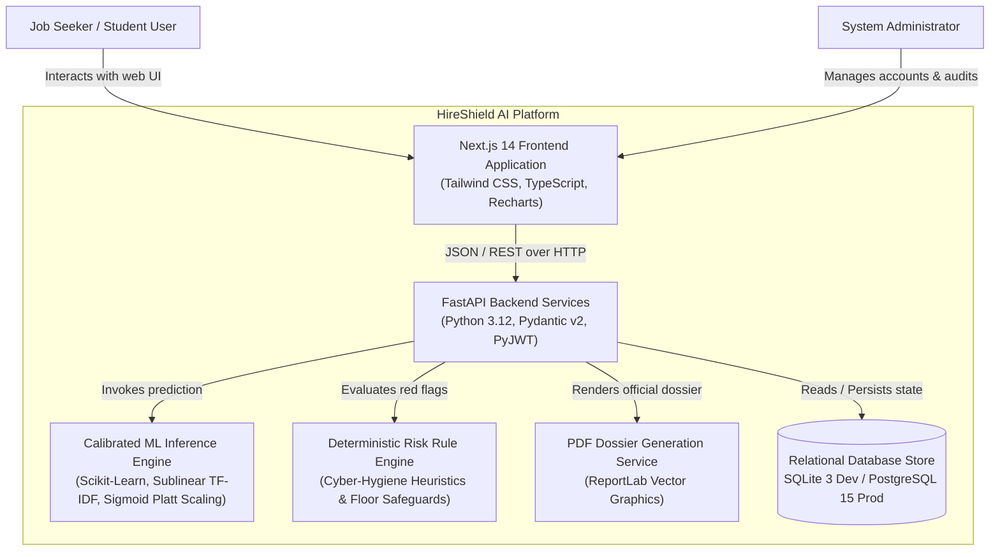
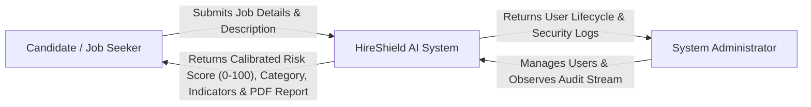
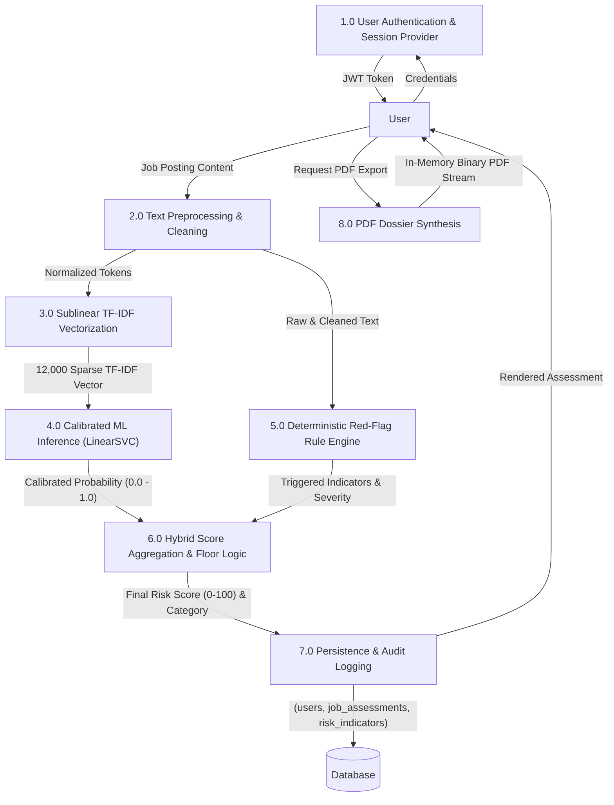
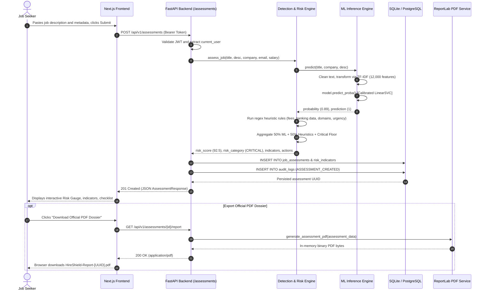

# HireShield AI — System Architecture & Technical Design

## 1. Executive Architecture Summary
HireShield AI is engineered as a modern, decoupled three-tier enterprise web application designed to evaluate employment postings and internship offers. It combines statistical machine learning (Calibrated Linear Support Vector Classifier with Sublinear TF-IDF feature extraction) with deterministic cybersecurity heuristics (red-flag rule detection, payment demand isolation, and domain integrity checks) to protect job seekers from recruitment fraud and identity theft.

---

## 2. System Context Diagram (C4 Level 1)

---

## 3. Data Flow Diagrams (DFD)

### A. Level 0 DFD (Context Level)

### B. Level 1 DFD (Decomposed Process View)

---

## 4. Assessment Lifecycle Sequence Diagram

---

## 5. Technology Stack Summary

| Layer | Component | Version | Rationale & Selection Criteria |
| :--- | :--- | :--- | :--- |
| **Frontend** | Next.js (App Router) | 14.2.35 | Server and client component rendering, zero-config routing, rapid build times. |
| **Styling** | Tailwind CSS | 3.4.3 | Responsive design, clean utility classes, consistent color tokens. |
| **Visualization** | Recharts | 2.12.7 | Interactive SVG charts for risk category breakdown and activity timelines. |
| **Backend** | FastAPI | 0.165.0 | High-performance asynchronous REST API framework, Pydantic v2 schema validation, automatic OpenAPI /docs. |
| **Server** | Uvicorn | 0.54.0 | ASGI web server for asynchronous Python execution. |
| **ORM** | SQLAlchemy | 2.1.9 | Declarative ORM mapping with cross-database support (SQLite / PostgreSQL). |
| **Migrations** | Alembic | 1.20.1 | Database schema migrations and tracking. |
| **Machine Learning** | Scikit-Learn | 1.9.1 | Production-ready TF-IDF extraction, LinearSVC classifier, CalibratedClassifierCV. |
| **Security** | PyJWT & BCrypt | 2.15.1 / 5.0.0 | Industry-standard salted cryptographic password hashing and stateless token issuance. |
| **Reporting** | ReportLab | 5.1.0 | Vectorized, publication-grade in-memory PDF generation. |
| **Testing** | Pytest & TestClient | 9.2.0 | Automated regression testing for APIs, isolation, and detection rules. |
