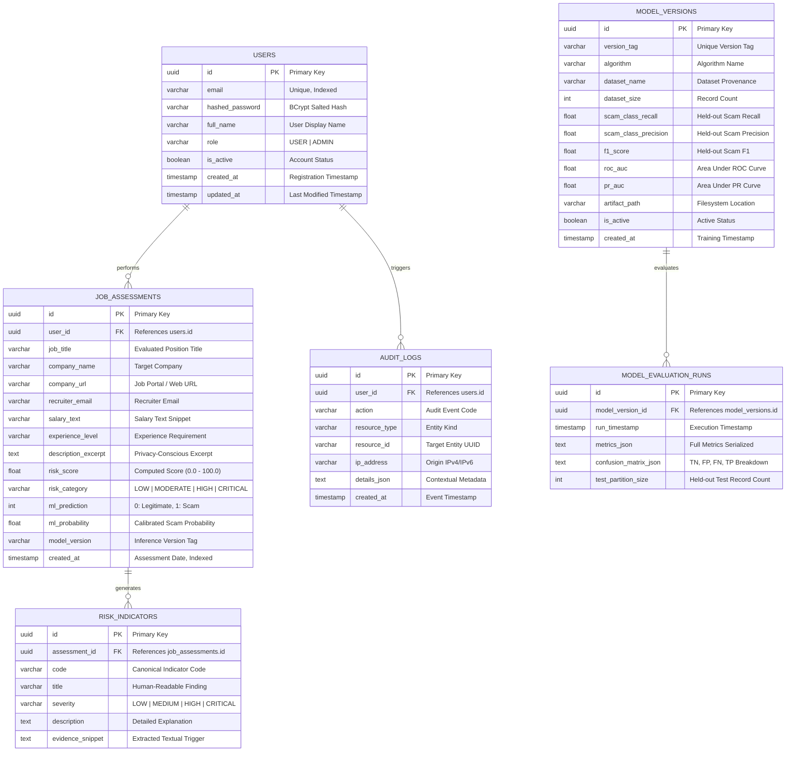

# HireShield AI — Database Architecture & Schema Design

## 1. Relational Entity-Relationship Diagram (ERD)

---

## 2. Table Specifications & Constraints

### A. `users`
- **Primary Key**: `id` (`VARCHAR(36)` UUID v4 string).
- **Index**: Unique index on `email` (`LOWER(email)` normalized).
- **Cascade**: Deleting a user cascades to remove all associated `job_assessments` and nullifies references in `audit_logs`.

### B. `job_assessments`
- **Primary Key**: `id` (`VARCHAR(36)` UUID v4 string).
- **Foreign Key**: `user_id -> users.id` with `ON DELETE CASCADE`.
- **Composite Index**: `idx_assessment_user_created (user_id, created_at DESC)` for fast paginated queries.
- **Privacy Preservation**: Raw 25,000-character job postings are truncated to an essential 1,000-character excerpt (`description_excerpt`) to prevent storing unnecessary personal data.

### C. `risk_indicators`
- **Primary Key**: `id` (`VARCHAR(36)` UUID v4 string).
- **Foreign Key**: `assessment_id -> job_assessments.id` with `ON DELETE CASCADE`.
- **Fields**: Canonical rule codes (e.g. `ADVANCE_PAYMENT_DEMAND`, `PUBLIC_EMAIL_DOMAIN`, `SENSITIVE_DATA_SOLICITATION`).

### D. `model_versions` & `model_evaluation_runs`
- Tracks the active ML artifact version (`v1.0.0-emscad-nlp`), serialized hyperparameters, and evaluation metrics on the held-out test split.

### E. `audit_logs`
- Implements security traceability for authentication attempts, assessment deletions, and administrative status alterations.
