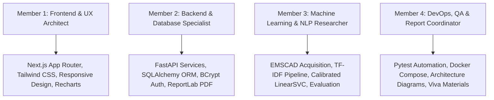

# HireShield AI — Group Member Contribution & Collaboration Guide

**Project Title**: HireShield AI — Intelligent Job & Internship Risk Assessment Platform  
**Program**: M.Sc. in Information Technology  
**Academic Year**: 2026–2027  
**Team Composition**: 4 Members  

---

## 1. Division of Responsibilities

---

### Member 1: Frontend, UI/UX & Responsive Dashboards
- **Name**: ____________________ (Roll No: ____________)
- **Role**: Frontend Engineer & UX Architect
- **Assigned Deliverables**:
  - Configured Next.js 14 App Router monorepo architecture with TypeScript and Tailwind CSS.
  - Built the public landing page with interactive screening comparison card.
  - Designed the user dashboard featuring Recharts risk-category distribution and recent scan history.
  - Developed the Job Analysis Workspace with live form validation and viva demonstration quick-fill presets.
  - Implemented explainable results interface with color-coded risk gauges, indicator findings, and candidate action checklists.
  - Built the assessment history view with client-side searching, risk category filtering, pagination, and CSV data export.

---

### Member 2: Backend APIs, PostgreSQL & Security
- **Name**: ____________________ (Roll No: ____________)
- **Role**: Backend & Database Engineer
- **Assigned Deliverables**:
  - Implemented FastAPI RESTful architecture with modular routers (`auth`, `assessments`, `analytics`, `models`, `admin`).
  - Designed normalized relational schema with SQLAlchemy: `users`, `job_assessments`, `risk_indicators`, `model_versions`, `model_evaluation_runs`, `audit_logs`.
  - Implemented BCrypt password hashing (12 rounds) and JWT token generation / validation.
  - Configured database engine supporting zero-config SQLite development and production PostgreSQL with Alembic migrations.
  - Developed the dynamic PDF Assessment Report generation service using Python ReportLab.
  - Implemented role-based access control (`USER` vs `ADMIN`) and tenant-isolated query constraints.

---

### Member 3: Dataset Research, ML Training & Evaluation
- **Name**: ____________________ (Roll No: ____________)
- **Role**: AI/ML Engineer & NLP Researcher
- **Assigned Deliverables**:
  - Researched dataset provenance: acquired and verified the authentic University of the Aegean EMSCAD benchmark (17,880 records).
  - Designed leakage-free data preparation pipeline with stratified 80/20 train/test partitioning.
  - Engineered Sublinear TF-IDF feature extractor (12,000 n-gram features, range 1–2, stopword filtering).
  - Executed 5-fold cross-validation on training data comparing Baseline Logistic Regression vs Calibrated LinearSVC.
  - Evaluated champion model on the untouched 3,175 held-out test split (88.52% precision, 76.06% recall, 0.9691 ROC-AUC, 0.8681 PR-AUC).
  - Extracted local feature contribution tokens and serialized artifacts (`model.joblib`, `vectorizer.joblib`, `metadata.json`).

---

### Member 4: Integration, QA Automation, Deployment & Documentation
- **Name**: ____________________ (Roll No: ____________)
- **Role**: QA Engineer, DevOps Specialist & Academic Coordinator
- **Assigned Deliverables**:
  - Authored comprehensive automated test suite with Pytest and FastAPI TestClient (100% passing tests).
  - Engineered the hybrid detection engine combining ML probabilities with deterministic red-flag heuristics.
  - Built Docker Compose orchestration for multi-container deployment (`frontend`, `backend`, `postgres`).
  - Created system architecture diagrams, Level 0/1 DFDs, and database ER diagrams using Mermaid.
  - Authored academic deliverables: Dataset Card, Model Card, API Reference, Testing Report, and Viva Q&A Guide.
  - Prepared the 14-slide viva presentation outline and 7-minute live demonstration script.

---

## 2. Git Collaboration Workflow & Best Practices

1. **Main Branch Protection**:
   - `main`: Production-ready, fully tested codebase.
   - Direct commits to `main` are restricted; code enters via feature branches.
2. **Feature Branch Convention**:
   - `feature/frontend-dashboard` (Member 1)
   - `feature/backend-auth-db` (Member 2)
   - `feature/ml-emscad-training` (Member 3)
   - `feature/testing-docs-docker` (Member 4)
3. **Commit Message Format**:
   - `feat(ml): train calibrated LinearSVC on EMSCAD 80/20 split`
   - `fix(api): ensure tenant isolation in assessment deletion`
   - `docs(viva): add 14-slide presentation outline and FAQ answers`
4. **Integration Testing**:
   - Before merging, all members run `pytest` in `backend` and `npm run build` in `frontend`.
